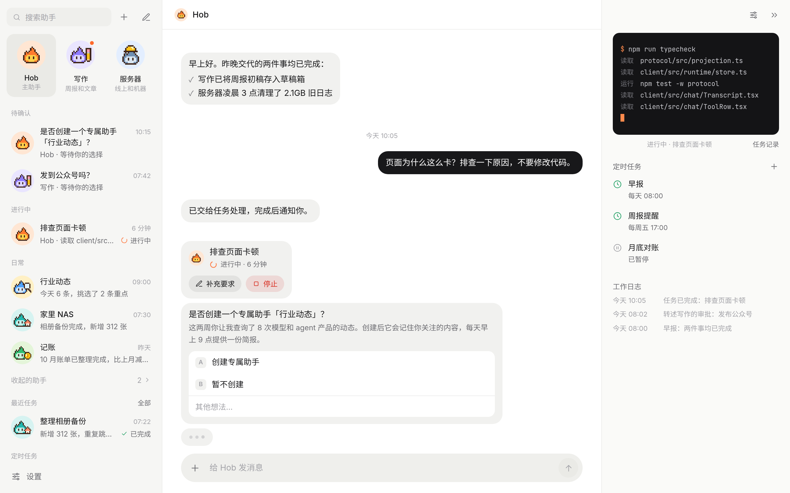
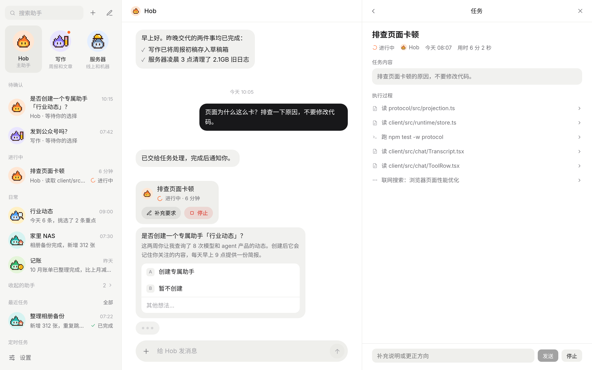
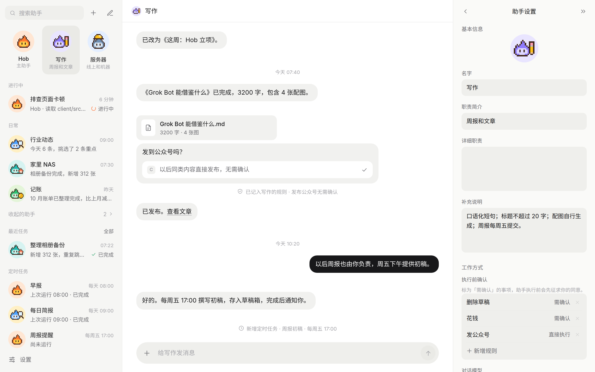
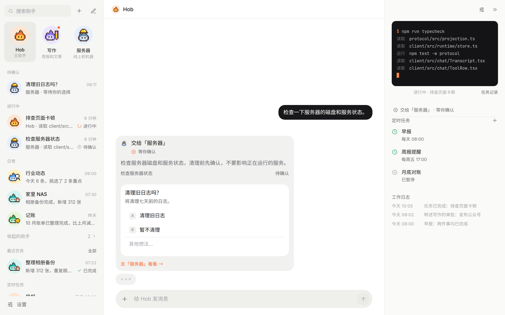
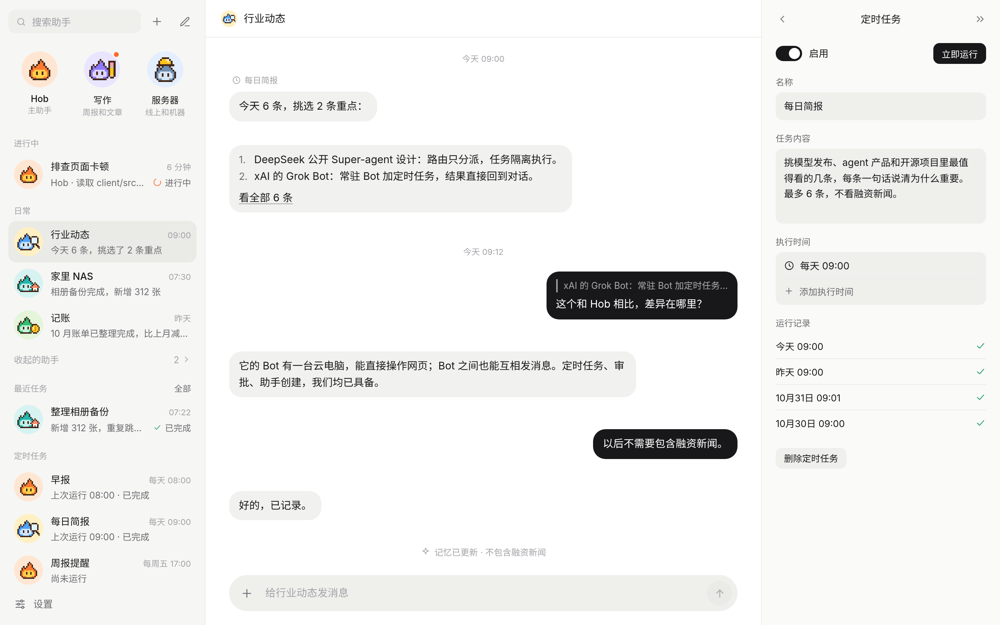
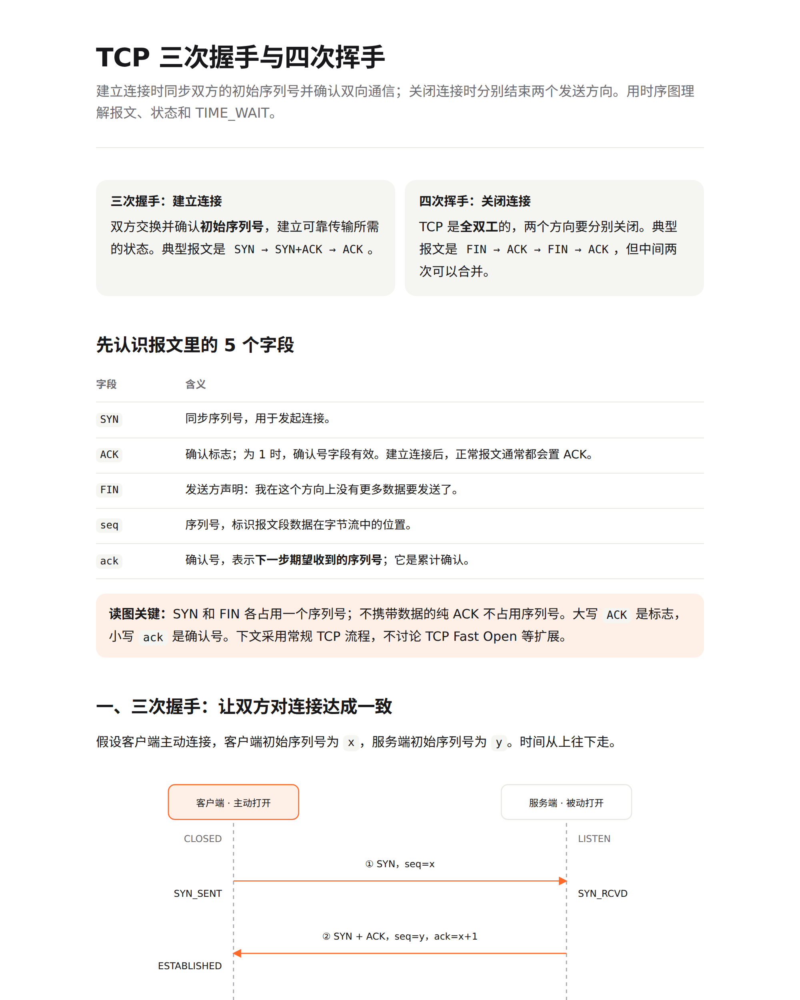
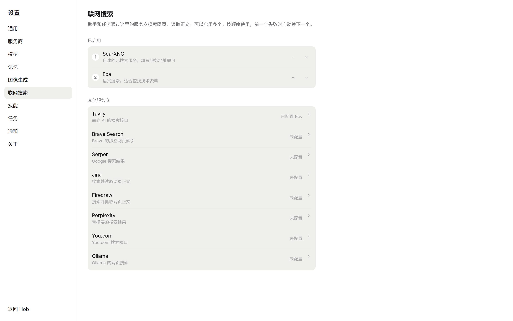
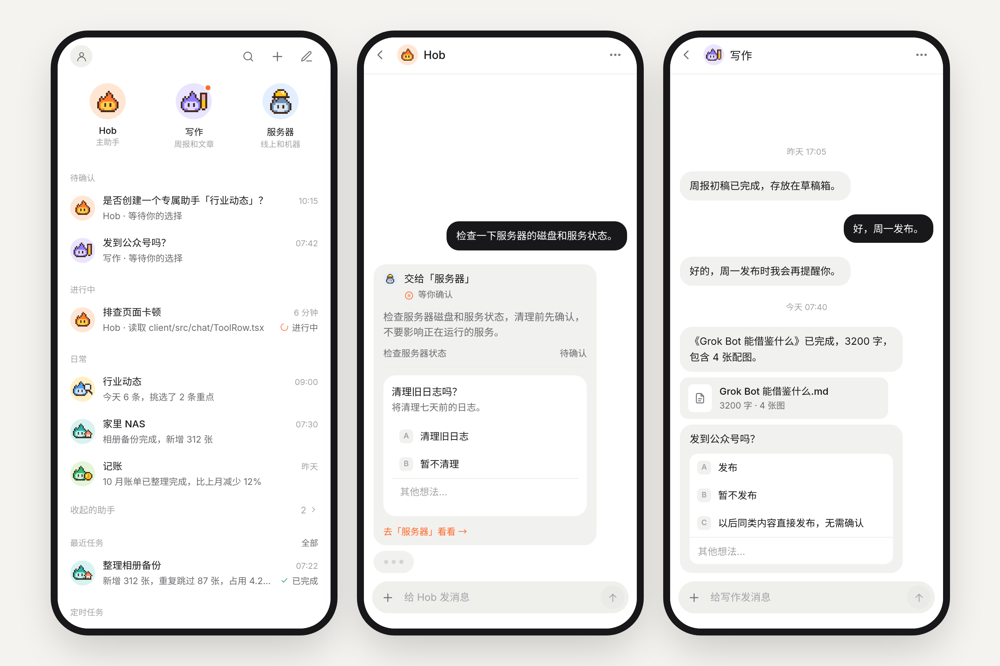
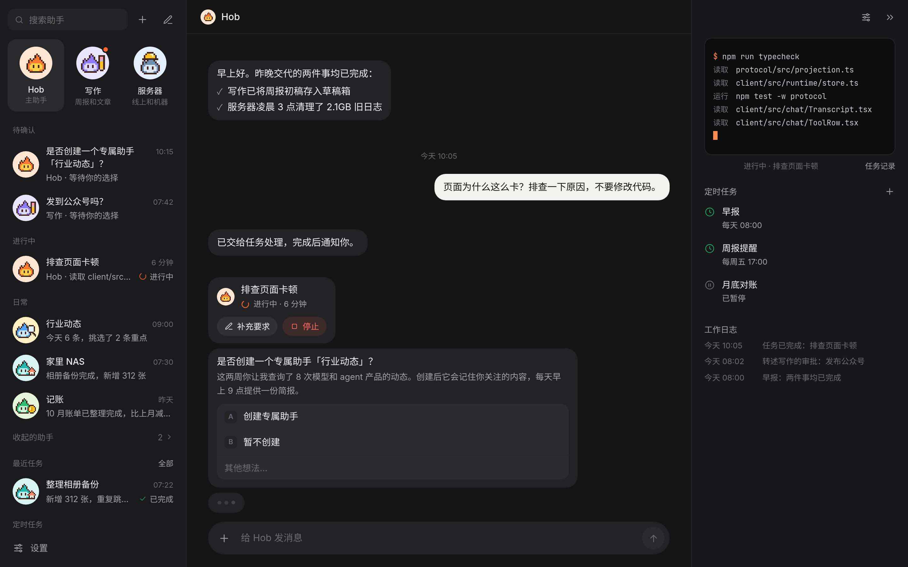

# Hob

**A self-hosted personal assistant that actually does the work.** You talk to one main assistant, Hob. It runs real work as background jobs, asks before anything risky, and when a kind of work keeps coming back, it proposes a dedicated assistant for it.

[中文说明](README.zh-CN.md) · [Architecture](docs/architecture.md) · MIT License

> The interface is currently Chinese-only. Hob is a single-user app you run on your own machine or server.



## What you get

**One conversation, real work.** Ask in plain language; Hob turns it into a job that runs in the background with its own shell, files and tools. A job card shows progress and elapsed time. Open it to follow every step live, add instructions mid-way, or stop it.



**Assistants that grow out of your habits.** When the same kind of request repeats, Hob suggests a dedicated assistant ("写作", "服务器", "记账" …). Each one keeps its own conversation, duties, approval rules, schedules and work log, and you configure all of it in one panel.



**Delegation you can see.** Hob hands work to the right assistant and keeps a delegation card in its own chat: status, linked jobs, and any pending question, which you can answer right on the card. When everything finishes, the result comes back to Hob, so you keep talking in one place.



**Asks first, then remembers.** Each assistant has "confirm before running" rules. Pick "always allow" once and it becomes a rule, so you won't be asked about that again.

**Schedules.** Daily briefs, weekly reports, month-end checks: routines run on cron-style schedules and post results into the assistant's conversation.



**Pages instead of walls of text.** For processes, comparisons or research, an assistant can answer with a single-page visual document. It opens in the side panel and renders live while the model is still writing.



**Tools that come with it:**

- **Web search** across 10 providers (SearXNG, Exa, Tavily, Brave, Serper, Jina, Firecrawl, Perplexity, You.com, Ollama), used in order with automatic fallback.
- **Skills** from Hob's own skill folder, the shared `~/.agents/skills`, and Lore. You can import skills from Claude Code, Codex and pi.
- **Long-term memory**, kept locally or in [Lore](https://github.com/FFatTiger/lore).
- **Image generation** through any OpenAI-compatible image API.
- **Push notifications** when an assistant needs your decision or a job finishes.



**Made for the phone too.** Hob is an installable web app with a mobile layout and Telegram-style gestures: swipe a message to reply, long-press for actions. Light and dark themes follow your system.





## Quick start

You need Node.js 22 or newer and an API key for at least one model provider.

```bash
git clone https://github.com/FFatTiger/hob.git
cd hob
npm install
npm run build
HOB_PASSWORD='choose-a-password' npm start
```

Open <http://127.0.0.1:30148> and sign in with that password. Then:

1. Go to **设置 → 服务商** (Settings → Providers) and add a provider. Built-in ones (Anthropic, OpenAI, Google, DeepSeek, OpenRouter, …) only need an API key; any OpenAI- or Anthropic-compatible endpoint works too.
2. Go to **设置 → 模型** (Settings → Models) and pick the models for chat and for jobs.
3. Send Hob a message. A reply, or a job card for real work, means you are set.

The password is hashed into `~/.hob/config.json` on first start, so later starts don't need `HOB_PASSWORD`. You can change it under **设置 → 通用**.

## Configuration

Startup options are environment variables. Everything else, including providers, models, memory, search, skills and notifications, lives in the settings UI and takes effect immediately.

| Variable | Default | Purpose |
| --- | --- | --- |
| `HOB_HOME` | `~/.hob` | Data directory |
| `HOB_PORT` | `30148` | HTTP port |
| `HOB_HOST` | `127.0.0.1` | Listen address |
| `HOB_PASSWORD` | — | Sign-in password; required on first start unless `password` is set in `config.json` |

Hob is self-contained. Conversations, jobs, memory, skills, keys and its engine state all live in `HOB_HOME`, and it never reads or changes other tools' configuration. To reuse providers or a Lore connection you already have on the machine, import them explicitly in settings. **Back up `HOB_HOME` and you have backed up everything.**

## Deploy

Hob is a single Node process. Run it with any process manager and put a reverse proxy with TLS in front. Push notifications and installing as an app both need HTTPS. A PM2 example is included:

```bash
pm2 start deploy/pm2.config.cjs   # process "hob", port 30148, data in ~/.hob
```

## Development

```bash
npm run dev:server   # API server with reload, port 30148
npm run dev:web      # Vite dev server; proxies /api to 30148
npm test             # vitest
npm run typecheck
```

Add `?mock=1` to the dev URL to run the UI against an in-browser fake backend. No model or server is needed, and the screenshots above were taken that way.

Stack: Node 22 + TypeScript, Hono with SSE, Vite + React with hand-written CSS. The agent engine is the [pi](https://github.com/earendil-works/pi) SDK, used in-process. Read [docs/architecture.md](docs/architecture.md) for the design, data layout and tool list (in Chinese).

## License

[MIT](LICENSE)
