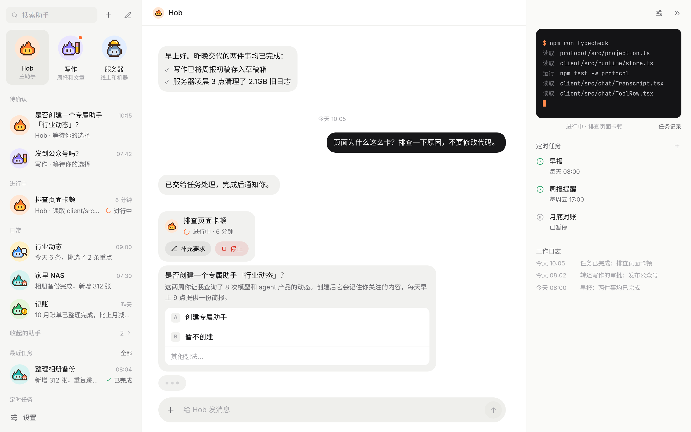

# Hob

**一个自己部署、真正动手干活的私人助手。** 你只跟主助手 Hob 说话：它把要做的事交给后台任务执行，有风险的操作先问你；同一类活反复出现时，它会提议分出一个专门的助手。

[English](README.md) · [架构说明](docs/architecture.md) · MIT 许可证

> 目前界面只有中文。Hob 是单用户应用，运行在你自己的电脑或服务器上。



## 能做什么

**一条对话，真实干活。** 用平常的话提要求，Hob 会派出任务在后台执行，任务有自己的命令行、文件和工具。任务卡上能看到进度和用时，点开可以实时看每一步，中途补充要求，或者直接停止。

**从习惯里长出来的助手。** 同类要求反复出现时，Hob 会提议创建专门的助手，比如「写作」「服务器」「记账」。每个助手有自己的对话、职责、执行前确认规则、定时任务和工作日志，都在同一个面板里设置。

**看得见的委派。** Hob 把事交给合适的助手后，在自己的对话里留一张委派卡，上面有状态、关联任务和待确认的问题，问题可以直接在卡上回答。全部完成后结果回到 Hob，你始终只在一个地方说话。

**先问，再记住。** 每个助手都有执行前确认规则。选一次「一直允许」就会记成规则，以后同类操作不再问。

**定时任务。** 每日简报、周报、月底对账，按 cron 式的时间表运行，结果发到对应助手的对话里。

**用页面代替大段文字。** 讲流程、做对比、写调研时，助手可以交一页图文页面。页面在侧栏打开，模型边写边显示。

**自带的能力：**

- **联网搜索**：支持 10 个服务商（SearXNG、Exa、Tavily、Brave、Serper、Jina、Firecrawl、Perplexity、You.com、Ollama），按顺序使用，失败时自动换下一个。
- **技能**：读取 Hob 自己的技能目录、通用的 `~/.agents/skills` 和 Lore，可以从 Claude Code、Codex、pi 导入。
- **长期记忆**：保存在本地，或接入 [Lore](https://github.com/FFatTiger/lore)。
- **图像生成**：接任意 OpenAI 兼容的图像接口。
- **推送通知**：助手需要你确认、任务结束时通知你。

**手机上也好用。** Hob 可以安装成网页应用，手机上是专门的布局，交互照 Telegram：向左滑动消息即可回复，长按弹出菜单。支持亮色和暗色主题。


## 快速开始

需要 Node.js 22 或更高版本，以及至少一个模型服务商的 API Key。

```bash
npm install -g hob-bot
HOB_PASSWORD='设一个密码' hob
```

不想全局安装，也可以直接运行一次：`HOB_PASSWORD='设一个密码' npx hob-bot`。

打开 <http://127.0.0.1:30148>，用这个密码登录，然后：

1. 到 **设置 → 服务商** 添加服务商。内置服务商（Anthropic、OpenAI、Google、DeepSeek、OpenRouter 等）只需填 API Key；OpenAI 或 Anthropic 兼容接口也可以用。
2. 到 **设置 → 模型** 选好对话和任务使用的模型。
3. 给 Hob 发一条消息。收到回复，或者出现一张任务卡，就说明配置好了。

首次启动时密码会转成哈希写进 `~/.hob/config.json`，之后启动不用再带 `HOB_PASSWORD`。改密码在 **设置 → 通用**。

## 配置

启动项用环境变量设置。服务商、模型、记忆、搜索、技能、通知等其余设置都在界面里，改完立即生效。

| 变量 | 默认值 | 作用 |
| --- | --- | --- |
| `HOB_HOME` | `~/.hob` | 数据目录 |
| `HOB_PORT` | `30148` | HTTP 端口 |
| `HOB_HOST` | `127.0.0.1` | 监听地址 |
| `HOB_PASSWORD` | — | 登录密码；首次启动必填，除非 `config.json` 里已写了 `password` |

Hob 是独立的：对话、任务、记忆、技能、Key 和引擎数据都在 `HOB_HOME` 里，不读也不改本机其他工具的配置。想沿用本机已有的服务商或 Lore 连接，可以在设置里主动导入。**备份 `HOB_HOME` 就备份了全部数据。**

## 部署

Hob 是单个 Node 进程。用任意进程管理器运行，前面加一层带 TLS 的反向代理即可。推送通知和安装成应用都需要 HTTPS。用 PM2 的话：

```bash
pm2 start hob --name hob           # npm install -g hob-bot 之后
pm2 start deploy/pm2.config.cjs   # 或者在源码目录里：进程名 hob，端口 30148，数据在 ~/.hob
```

## 开发

```bash
git clone https://github.com/FFatTiger/hob.git
cd hob
npm install
npm run build
npm start            # 从源码运行，等同于 hob 命令
npm run dev:server   # 后端，改动自动重载，端口 30148
npm run dev:web      # Vite 开发服务器，/api 代理到 30148
npm test             # vitest
npm run typecheck
```

开发地址加上 `?mock=1`，界面会使用浏览器内的模拟后端，不需要模型和服务端。上面的截图就是这样拍的。

技术栈：Node 22 + TypeScript，Hono + SSE，Vite + React，CSS 全部手写。智能体引擎是进程内运行的 [pi](https://github.com/earendil-works/pi) SDK。设计、数据布局和工具列表见 [docs/architecture.md](docs/architecture.md)。

## 许可证

[MIT](LICENSE)
